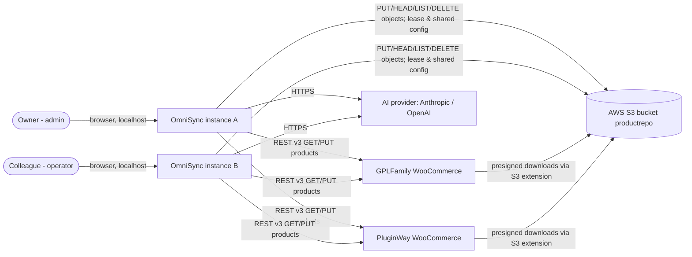
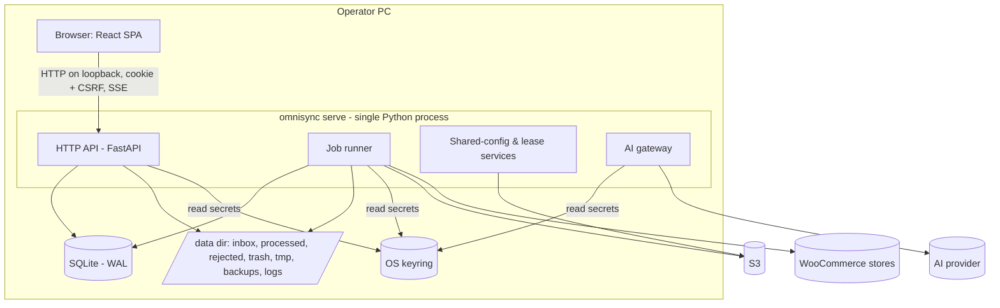
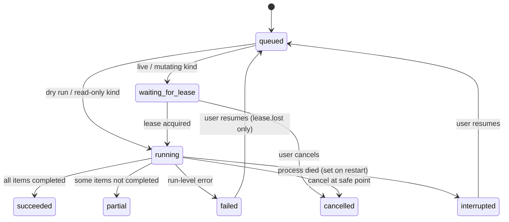
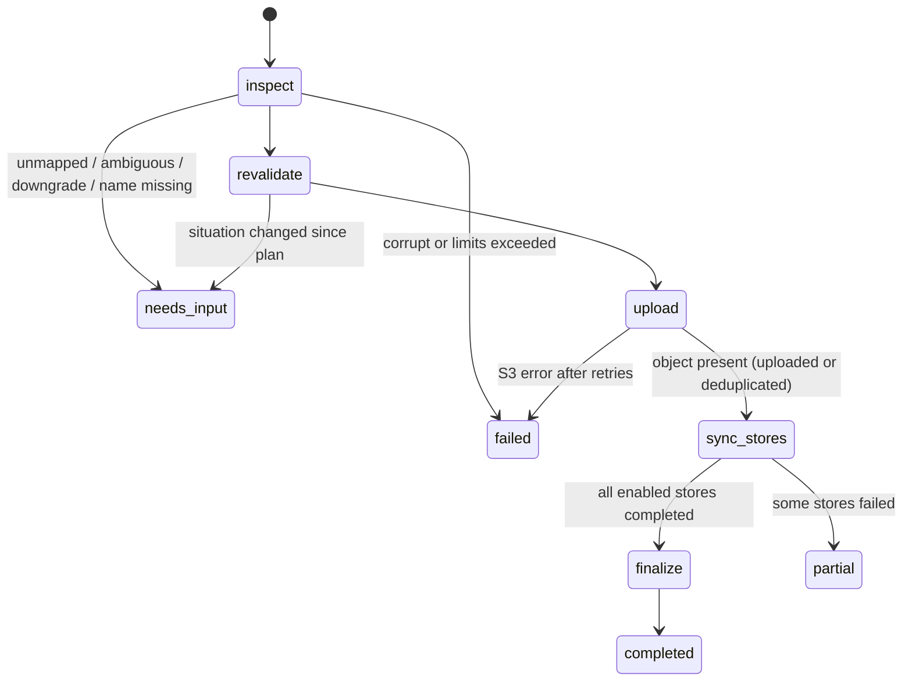
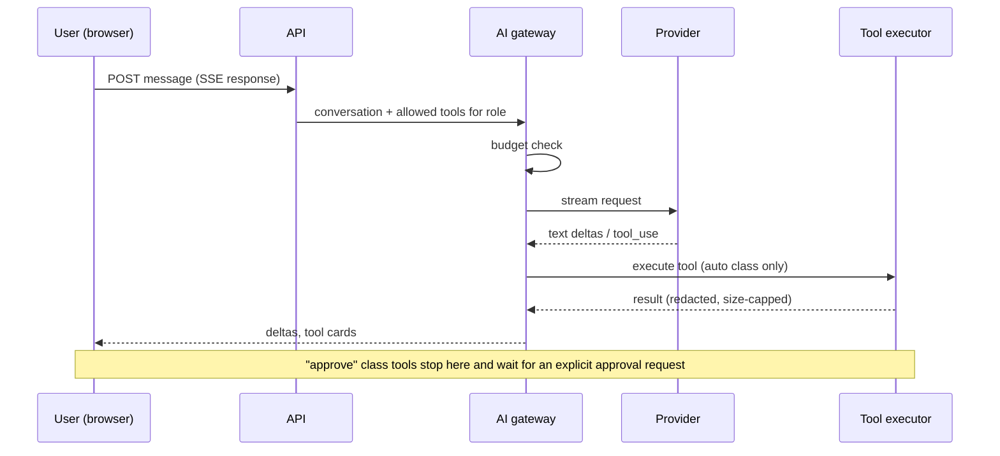

# Architecture

> **Status:** Accepted (approved design, not yet implemented) · **Owner:** TecHaust Technologies (@techaust) · **Last reviewed:** 2026-10-11 · **Audience:** engineers and reviewers

This document describes how OmniSync 2.0 is built to satisfy [02-PRODUCT-REQUIREMENTS](02-PRODUCT-REQUIREMENTS.md). The decisions behind it are recorded in the [ADRs](adr/README.md). Data structures are in [04-DATA-MODEL](04-DATA-MODEL.md) and the HTTP contract is in [05-API-SPEC](05-API-SPEC.md).

## 1. Architectural drivers

| Driver | Consequence |
|---|---|
| Correctness of publishing (exactly-once upload, no broken downloads) | Deterministic pipeline, idempotent steps, verify-after-write, lease-guarded mutations |
| Proven legacy domain logic (≈1,500 LOC, 194 tests) | Keep Python and port the domain core with its tests ([ADR-0002](adr/0002-python-fastapi-backend.md)) |
| Single operator per instance, low volume (≤ 100 archives/day) | One process, SQLite, no message broker ([ADR-0003](adr/0003-sqlite-database.md), [ADR-0004](adr/0004-in-process-job-runner.md)) |
| Two independent instances share one bucket and the same stores | S3 conditional-write lease plus shared config ([ADR-0007](adr/0007-multi-instance-coordination-via-s3.md)) |
| Browser UX with live progress | React SPA plus SSE ([ADR-0005](adr/0005-react-typescript-spa.md), [ADR-0006](adr/0006-server-sent-events.md)) |
| AI that helps without taking control | Server-side gateway, typed tools, approval gates ([ADR-0008](adr/0008-ai-gateway-and-approval.md)) |

## 2. System context (C4 level 1)



*Text description:* Each person uses their own OmniSync instance through a browser on their own PC. Both instances talk to the same S3 bucket (for installables and for coordination data under the control prefix), to the same WooCommerce stores, and optionally to an AI provider. The stores serve downloads from S3 through the Amazon S3 Storage extension, which is why a superseded object must never be deleted while a store still references it.

## 3. Containers (C4 level 2)



*Text description:* The browser loads the single-page app from the same Python process that serves the API. That process also hosts the job runner, the coordination services and the AI gateway. Persistent state lives in SQLite. Files live in the data directory. Secrets are read from environment variables or the OS keyring and never leave the process except towards the service they authenticate.

| Container | Technology | Responsibility |
|---|---|---|
| SPA | React, TypeScript, Vite, TanStack Query, React Router, Tailwind CSS, Radix UI primitives | UI. Holds no secrets or business rules beyond input validation. |
| HTTP API | FastAPI on Uvicorn (exactly **1 worker**) | AuthN/AuthZ, validation, REST, SSE, static SPA hosting |
| Job runner | Python threads with a DB-backed queue | Executes runs; reports progress events |
| Coordination | boto3 S3 conditional writes | Lease, shared-config sync, shared audit, pending deletes |
| AI gateway | Official `anthropic` and `openai` SDKs behind one interface | Provider calls, tool loop, budgets, usage records |
| Database | SQLite 3 (WAL, `synchronous=FULL`, `foreign_keys=ON`) via SQLAlchemy 2 and Alembic | All local state |
| Secrets | `keyring` (Windows Credential Manager) with environment override | Credential storage |

## 4. Components (C4 level 3, backend)

```text
backend/omnisync/
  (source lives under backend/src/omnisync/; the src layout keeps tests from importing the working tree by accident)
  core/            pure domain logic, no I/O except reading archive bytes
    archive.py       safe ZIP reader (limits, spooling)          FR-MATCH-05
    versions.py      layer 1/2/3 + deep scan, PEP 440 compare     FR-MATCH-01
    slugs.py         slug detection, slugify, filename cleaning    FR-MATCH-02
    matching.py      cascade + candidate choice                    FR-MATCH-03/04
    catalog.py       build/normalise/heal catalog from products    FR-CAT-01
    shortcodes.py    shortcode and URL parsing
    plan.py          plan model and diffing (plan vs. now)         FR-RUN-04
  services/
    s3.py            uploads (streamed), HEAD (404-only = missing), list, delete
    woocommerce.py   client: rate gate, retry, breaker, product lock, verify
    lease.py         S3 lease acquire/renew/release               FR-COORD-01/02
    shared_config.py pull/push with ETags, merge, conflicts       FR-COORD-03
    secrets.py       env -> keyring resolution, write-only API
    inspection.py    archive -> candidates -> match -> plan
    ai/              gateway.py, providers/{anthropic,openai}.py, tools.py, resolver.py, budget.py
  jobs/
    runner.py        queue, lanes, cancellation, resume, events
    pipeline.py      stage machine per item (section 5)
    catalog_refresh.py, cleanup.py, legacy_import.py
  api/               routers per resource, dependencies (auth, csrf, roles), problem+json errors
  db/                models.py, session.py, migrations/ (Alembic)
  security/          passwords (argon2id), sessions, csrf, host check, rate limits
  settings.py        pydantic-settings (env prefix OMNISYNC_)
  cli.py           serve, check, import-legacy, backup, restore, create-admin, reset-password, eval,
                   install-task, uninstall-task
```

*Dependency rule:* `core` imports nothing from `services`, `jobs`, `api` or `db`. `services` may import `core`. `jobs` may import both. `api` calls `jobs` and `services` but never `core` internals directly. An import-linter contract in CI enforces this (Milestone 3).

## 5. Pipeline

### 5.1 Run lifecycle



*Text description:* A run starts `queued`. Mutating runs wait for the lease, while read-only runs start immediately. A running run ends as `succeeded`, `partial`, `failed` or `cancelled`. If the process dies, the run is marked `interrupted` on the next start, and the user may resume it. A run that failed because its lease was lost can also be resumed. Resuming re-queues it.

**Terminal states of dry runs.** A dry run's job is to produce a plan, so it ends `succeeded` whenever a plan was produced, even if some items are excluded (needs-input, invalid). Excluded items are listed in the plan and counted in `counters.needs_input` and `counters.failed`. A dry run ends `failed` only on a run-level error. A live run created from it processes only the plan's ready items (FR-RUN-04).

### 5.2 Item stages (live pipeline)



*Text description:* Each archive is inspected (or its cached inspection reused). It is then re-validated against the confirmed plan using live read-only checks. The installable is uploaded or deduplicated, then each enabled store is updated. Finalisation deletes or records the superseded object and moves the archive. Decisions the system cannot make go to the needs-input queue instead of failing.

| Stage | Behaviour | Safe point after? |
|---|---|---|
| inspect | Safe ZIP read, candidates, match cascade. The chosen nested payload is spooled to `tmp/<run>/<item>.zip` (FR-MATCH-05). | yes |
| revalidate | S3 HEAD for the target key; WooCommerce GET for live `latest_version_<slug>`; downgrade check (FR-PIPE-06); entry selection (FR-PIPE-05). Differences from the plan go to needs-input (FR-RUN-04). | yes |
| upload | Skip if HEAD shows the same `content-md5-hex`. Otherwise use a streamed PUT (≤ 8 MiB) or a multipart upload with 8 MiB parts, with metadata. 404 is the only "missing" (FR-PIPE-03). The lease write deadline is checked before every part (section 6.2); if it has passed, the multipart upload is aborted. | yes |
| sync_stores | Per store: product lock → GET → modify → PUT → verify (FR-PIPE-04). Stores proceed independently; the breaker isolates outages. The write deadline is checked before every PUT. | yes, between stores |
| finalize | If all enabled stores are complete: reference-check the old key against the catalog of **every configured store, enabled or disabled**. Delete only if no other entry references it, every catalog is younger than 26 h (kept fresh by the automatic daily refresh, FR-CAT-04), and the credentials permit it; otherwise record a pending delete (FR-PIPE-07). Then move the archive (FR-PIPE-08). | — |

**Write deadline.** Every mutating external call checks the lease write deadline immediately before it is sent: S3 PUT, part upload, complete-multipart, delete, and WooCommerce PUT. Each mutating call also has a **total** deadline of 60 s, enforced by a wrapper that cancels the request. This is in addition to the HTTP library's per-step connect, read and write timeouts, which do not bound a whole request. With at most 8 MiB per call, this requires an upload bandwidth of at least about 1.2 Mbit/s; the supported minimum is 2 Mbit/s ([10-OPERATIONS §1](10-OPERATIONS.md#1-requirements)). Read-only calls are not gated.

### 5.3 Concurrency inside one instance

- **Lanes.** The *mutating lane* runs one run at a time (live pipeline, catalog refresh, cleanup execute, legacy import). The *read-only lane* runs up to 2 at a time (dry runs, cleanup previews). Inspections on arrival use a separate pool of 2 workers.
- **Items.** Within a pipeline run, a thread pool of `concurrency` items (1–8, default 4) processes archives in parallel.
- **Locks kept from legacy.** Per slug (two archives with the same slug run serially) and per `(store, product_id)` (read-modify-write never interleaves for bundle products) (`legacy:omnisync/engine.py:133-138`, `legacy:omnisync/wc.py:53-57`).
- **Rate gate.** Per store host, minimum spacing `request_delay` (default 0.15 s). The sleep happens outside the lock (`legacy:omnisync/wc.py:21-36`).
- **Database access.** One SQLAlchemy engine; short transactions; progress events batched at most every 250 ms per run to limit write amplification.
- **Admission.** Creating a mutating run (live pipeline, catalog refresh, cleanup execute, legacy import) of a kind that already has a `queued`, `waiting_for_lease` or `running` run on this instance returns `409 run.already_active` (no duplicate work). Different mutating kinds queue behind each other in the mutating lane. Contention with another instance is never an error: the run waits in `waiting_for_lease`.

### 5.4 Idempotency and resume

Every external step checks the live system before acting:

| Step | Check before acting | Result if already done |
|---|---|---|
| Upload | HEAD key: `content-md5-hex` metadata equals the local MD5 | skip (`s3_skips`) |
| Store update | GET product: the selected entry already has shortcode `<key>` and the meta version equals the target | skip (`wc_skips`) |
| Delete old | HEAD old key: 404 | skip |
| Move archive | Destination exists with the same SHA-256 | remove the source |

That is why resuming an `interrupted` run simply re-executes all non-completed items (NFR-REL-01).

## 6. Multi-instance coordination

The decision and alternatives are in [ADR-0007](adr/0007-multi-instance-coordination-via-s3.md).

### 6.1 Control prefix layout

```text
s3://<bucket>/<control prefix>            default "_omnisync/"
  control/lease.json                      the lease (6.2)
  config/shared.json                      shared config document (6.3)
  audit/YYYY/MM/DD/<ts>-<instance>-<uuid>.json   shared audit events (write-once)
  pending-deletes/<urlencoded key>.json   pending deletes (write-once, removed by admin cleanup)
  probes/<instance>.json                  capability probe written by "Test S3"
```

*Text description:* Every coordination object lives under one prefix in the product bucket. The lease and shared config are single objects updated with ETag preconditions. Audit events and pending deletes are write-once objects. The bucket name and prefix are configurable.

### 6.2 Lease protocol

The lease document is:

```json
{
  "schema": 1,
  "holder_instance_id": "c2f0…",
  "holder_instance_name": "owner-pc",
  "holder_user": "owner",
  "operation": "pipeline_live",
  "run_id": 418,
  "acquired_at": "2026-10-11T10:00:00Z",
  "renewed_at": "2026-10-11T10:00:30Z",
  "expires_at": "2026-10-11T10:05:30Z",
  "released": false
}
```

All lease timestamps are in **S3 time**: `s3_now()` is the local monotonic clock plus an offset estimated from S3 `Date` headers (section 6.4). Local wall clocks are never used for lease decisions.

| Operation | Request | Outcome |
|---|---|---|
| **Acquire (fresh)** | `PutObject` with `If-None-Match: *` | 200 → held (remember ETag). 412 or 409 → go to *takeover check*. |
| **Takeover check** | `GetObject` → body and ETag `E` | If `released` is true or `s3_now() > expires_at + takeover_grace`: `PutObject` with `If-Match: E` (200 → held; 412/409 → busy). Otherwise → busy, report the holder. |
| **Renew** (every 30 s) | `PutObject` with `If-Match: <my ETag>`, new `renewed_at`, `expires_at = s3_now() + ttl` | 200 → update ETag and write deadline. 412 → **lease lost**: no further mutating call is sent; the run ends `failed` with `lease.lost`. Network error or uncertain S3 time → keep retrying until the write deadline passes, then end `failed` with `lease.lost` (detail `clock_uncertain` where applicable). Runs that failed with `lease.lost` can be resumed like `interrupted` runs. |
| **Release** | `PutObject` with `If-Match: <my ETag>` and `released: true` | 412 → already lost; nothing to do. The object is never deleted, so a release can never remove another holder's lease. |

Parameters: `ttl = 300 s`, `renew_interval = 30 s`, `write_deadline = expires_at − 120 s`, `takeover_grace = 30 s`, mutating-call total deadline 60 s, takeover polling every 15 s while `waiting_for_lease`. A healthy holder renews every 30 s, so its write deadline always lies 150–180 s in the future and is never reached.

**Safety argument.**

1. S3 conditional writes are atomic per key, so at most one writer succeeds against a given ETag.
2. A holder **sends** no mutating call after `expires_at − 120 s`, by its S3-time estimate. The client abandons every call after 60 s.
3. A taker cannot acquire before `expires_at + 30 s`, by its estimate.
4. Both parties measure in S3 time, each with an estimation error of at most 2 s (section 6.4).
5. In true S3 time, the last request is sent before `expires_at − 118 s`, and the earliest takeover is after `expires_at + 28 s`.
6. That leaves at least **146 s** for a sent request to finish, including any server-side processing that continues after the client gave up. Within the 60 s client deadline, it leaves at least 86 s to spare.
7. An abandoned upload whose body was not fully transmitted is rejected by S3, so it has no effect.

When the holder crashes, the other instance waits at most `ttl + takeover_grace` plus one polling interval, about 5.75 minutes.

**Known limitation.** Writes to product objects and WooCommerce are not fenced by a token. Suppose a holder process passes the deadline check and is then frozen (for example, a laptop suspended) before its request is sent, for longer than the time to the earliest takeover. That time is about 2.5 minutes in the worst case (renewals already failing) and about 5 minutes normally. On resume it may send that single request after a takeover. This residual risk is accepted and documented as T-11 in [06-SECURITY](06-SECURITY.md#6-threat-model). Every step's idempotent pre-check (section 5.4) limits the effect, and no further call follows, because every later call re-checks the deadline.

### 6.3 Shared config

`config/shared.json` holds `schema`, `version` (a monotonic integer), `updated_at`, `updated_by`, `stores[]` (key, label, base URL, enabled; no secrets), `aliases{}`, `overrides{}`, `download_names{}`, `policies{downgrade: "hold"}` and `history[]` (last 500 changes).

- **Pull:** on start, every 60 s, and before every run. A changed ETag means the document is fetched and replaced in the local cache tables.
- **Push:** apply the change locally to a copy, increment `version`, and `PutObject` with `If-Match: <cached ETag>`. On 412, re-pull, re-apply the same logical change (rules are keyed, so most changes merge cleanly), and retry once. If the same key was changed differently, return `409 config.conflict` to the UI with both values.
- **Bootstrap:** if the object does not exist, the first instance creates it with `If-None-Match: *`, seeded from legacy import or defaults.

### 6.4 Clock skew

Every S3 response carries a `Date` header with 1-second resolution. For each coordination call, the lease service records the request's send and receive times on the local monotonic clock and estimates `offset = s3_date + 0.5 s − (send + receive) / 2`. It keeps the estimate from the sample with the smallest round-trip time among the last 10 calls. The estimation error is bounded by `0.5 s + RTT / 2`. If the best RTT exceeds 3 s (error bound > 2 s), the instance does not acquire or renew the lease until the network recovers. A run that has not yet acquired the lease stays in `waiting_for_lease`, with the reason `clock_uncertain` shown. A running run is handled as in the *Renew* row of section 6.2.

Separately, the health page warns when the local wall clock differs from S3 time by more than 10 s. This affects only displayed timestamps, not lease safety.

## 7. AI architecture

Summary only; the full design is in [07-AI-DESIGN](07-AI-DESIGN.md).



*Text description:* The browser sends a chat message. The gateway checks the budget, calls the provider with the tools the user's role allows, and streams the answer back. Read-only and proposal tools run automatically. Tools that change things produce an approval card and run only when the user approves them, using the same service functions and permission checks as the regular UI.

## 8. Cross-cutting concerns

| Concern | Approach |
|---|---|
| **Errors** | Domain exceptions carry a stable `code` (e.g. `s3.access_denied`). The API returns RFC 9457 problem details ([05-API-SPEC §3](05-API-SPEC.md#3-errors)). Run items store `error_code` and `error_detail`. |
| **Logging** | JSON lines to `<data>/logs/omnisync.jsonl` (rotating, 10 MB × 5) and to the console. Fields: `ts`, `level`, `event`, `request_id`, `run_id`, `item_id`, `instance`. Secret values are redacted by a filter (NFR-SEC-03). |
| **Configuration** | `pydantic-settings`: environment (`OMNISYNC_*`) → `<data>/omnisync.toml` → defaults. Runtime-editable settings live in the database (local) or the shared config (shared). Reference: [10-OPERATIONS §3](10-OPERATIONS.md#3-configuration-reference). |
| **Time** | UTC everywhere. The UI renders local time with a UTC tooltip. |
| **IDs** | Integer primary keys internally; run IDs shown as `R-418`; instance ID is a UUIDv4 generated at first start. |
| **Validation** | Pydantic models at the API boundary; Zod on the client for form UX only (the server is authoritative). |
| **Static assets** | The SPA is built to `frontend/dist` and served by FastAPI with hashed filenames and immutable caching. `index.html` is served per request with the signed-in user's colour-mode class on `<html>` (pre-paint theming without inline script, [08-UX-DESIGN §5.2](08-UX-DESIGN.md#52-other-tokens)) and a fresh CSP nonce, injected into a `<meta property="csp-nonce">` tag and passed to libraries that insert `<style>` elements (Radix scroll-lock through `get-nonce`), so the CSP needs no `unsafe-inline` ([06-SECURITY](06-SECURITY.md#7-security-controls) C-22). |
| **Events** | One `events` table (global IDs, optional `run_id`) feeds the run timelines, the global SSE stream and the notification centre ([04-DATA-MODEL §2.4](04-DATA-MODEL.md#24-intake-and-processing)). In the browser, one `SharedWorker` holds a single SSE connection that all tabs share, so the per-origin HTTP/1.1 connection limit is never exhausted. Where `SharedWorker` is unavailable, each tab opens one stream. |

## 9. Deployment view

- **Primary:** each PC runs `omnisync serve`, bound to `127.0.0.1:8765`, started manually or at log-on via Task Scheduler ([10-OPERATIONS](10-OPERATIONS.md)).
- **Process model:** a single Uvicorn worker is mandatory because the job runner and SQLite are in-process. A second `serve` on the same data directory is refused through an OS file lock on `<data>/instance.lock`.
- **Development and tests:** Linux/macOS/Windows; Docker Compose is provided for development only. Hosting on a server is a non-goal for 2.0.

## 10. Technology choices

| Area | Choice | Why (summary; see ADRs) | Rejected alternatives |
|---|---|---|---|
| Language (backend) | Python 3.12 | Reuse tested domain code | Node/TypeScript backend (rewrite risk) |
| Web framework | FastAPI | Typed, Pydantic, OpenAPI generation | Django (heavier), Flask (less typing) |
| HTTP client | httpx | Sync and async, timeouts, `respx` mocking | requests (legacy; sync only) |
| DB | SQLite + SQLAlchemy 2 + Alembic | Zero-ops, transactional, migratable | PostgreSQL (operational overhead for 1 user) |
| Jobs | In-process runner | No broker for ≤ 100 items/day | Celery/RQ + Redis |
| Real-time | SSE | One-way, auto-reconnect, simple | WebSockets |
| Front end | React + TS + Vite | Ecosystem, accessible primitives (Radix) | Svelte, Vue (both viable; smaller component ecosystems for accessible primitives) |
| Styling | Tailwind CSS + shadcn/ui (copied components), zinc + indigo tokens ([ADR-0013](adr/0013-design-system-shadcn-indigo.md)) | Consistency, accessible primitives, owned code, small CSS output | CSS-in-JS, Material UI, Radix Themes |
| Fuzzy matching | `rapidfuzz` (MIT) | Fast string similarity for candidate ranking | difflib (≈ 10–100× slower over 2,400 keys × N) |
| Passwords | `argon2-cffi` (argon2id) | Current OWASP recommendation | bcrypt |
| Packaging | `uv` with `uv.lock`; `npm` with `package-lock.json` | Reproducible installs | pip-tools |

All dependencies are pinned by lockfile. A new dependency needs a licence check (GPL-3.0-compatible), maintenance check (release in the last 12 months), and a security check (no open high CVEs), recorded in the PR ([CONTRIBUTING](../CONTRIBUTING.md#dependencies)).
