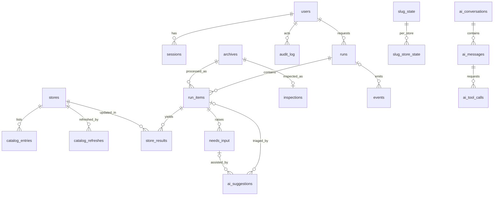

# Data Model

> **Status:** Proposed · **Owner:** TecHaust Technologies (@techaust) · **Last reviewed:** 2026-10-11 · **Audience:** backend engineers, reviewers

This document defines the local SQLite schema, the shared S3 documents, the file-system layout and the legacy import mapping. Column types are SQLite affinities as declared through SQLAlchemy. Every timestamp is a UTC ISO-8601 string (`TEXT`). Alembic migrations are the source of truth once implementation starts; this document must be updated in the same PR as any migration.

## 1. Entity-relationship overview



*Text description:* Users own sessions, request runs and appear as actors in the audit log. Stores have catalog entries and refresh history. Archives are inspected once and processed by run items. A run contains items and emits events; global events (archives, needs-input, lease) exist without a run. Each item yields one result per store and may raise needs-input items. AI suggestions attach either to a needs-input item (resolver, button name) or to a run item (triage). Slug state records the last published version per slug, with a child row per store. AI conversations contain messages, and messages may contain tool calls.

## 2. Tables

### 2.1 Identity and access

#### users

| Column | Type | Constraints | Notes |
|---|---|---|---|
| id | INTEGER | PK | |
| username | TEXT | UNIQUE, NOT NULL, 3–32 chars `[a-z0-9._-]` | |
| display_name | TEXT | NOT NULL | |
| password_hash | TEXT | NOT NULL | argon2id encoded string |
| role | TEXT | NOT NULL, CHECK in (`admin`,`operator`,`viewer`) | |
| failed_logins | INTEGER | NOT NULL DEFAULT 0 | |
| locked_until | TEXT | NULL | FR-AUTH-02 |
| disabled_at | TEXT | NULL | |
| preferences | TEXT (JSON) | NOT NULL DEFAULT `{}` | theme, density, notifications (FR-UX-04) |
| created_at, updated_at | TEXT | NOT NULL | |

#### sessions

| Column | Type | Constraints | Notes |
|---|---|---|---|
| id_hash | TEXT | PK | SHA-256 of the random 32-byte session token; the raw token exists only in the cookie |
| user_id | INTEGER | FK users ON DELETE CASCADE | |
| csrf_token | TEXT | NOT NULL | random 32 bytes, base64url |
| created_at, last_seen_at, expires_at | TEXT | NOT NULL | idle 12 h, absolute 7 d |
| user_agent | TEXT | NULL | display only |

### 2.2 Stores and catalog

#### stores

Local cache of the stores defined in the shared config.

| Column | Type | Constraints | Notes |
|---|---|---|---|
| key | TEXT | PK, `[a-z0-9-]{2,32}` | e.g. `gplfamily` |
| label | TEXT | NOT NULL | `GPLFamily` |
| base_url | TEXT | NOT NULL, `https://` only | API base = `<base_url>/wp-json/wc/v3` |
| enabled | INTEGER | NOT NULL | boolean |
| sort_order | INTEGER | NOT NULL | |

#### catalog_entries

| Column | Type | Constraints | Notes |
|---|---|---|---|
| id | INTEGER | PK | |
| store_key | TEXT | FK stores, NOT NULL | |
| mapping_key | TEXT | NOT NULL | normalised slug |
| product_id | INTEGER | NOT NULL | |
| product_slug | TEXT | NULL | for search |
| product_title | TEXT | NULL | for search and AI candidates |
| base | TEXT | NOT NULL | object base without `.zip` |
| download_name | TEXT | NOT NULL DEFAULT `''` | |
| is_primary | INTEGER | NOT NULL | |
| refresh_id | INTEGER | FK catalog_refreshes | |
| | | UNIQUE (store_key, mapping_key) | INDEX (store_key, product_id); INDEX (base) |

**catalog_refreshes**: `id`, `store_key`, `run_id`, `started_at`, `finished_at`, `status`, `product_count`, `entry_count`, `conflicts` (JSON list of `{mapping_key, product_ids[]}`).

### 2.3 Rules (local cache of shared config)

| Table | Key | Columns |
|---|---|---|
| **aliases** | detected_slug | mapping_key, source (`manual`/`ai_accepted`/`legacy_import`), updated_by, updated_instance, updated_at |
| **filename_overrides** | filename_lower | mapping_key, source, updated_by, updated_instance, updated_at |
| **download_names** | slug | name, source, updated_by, updated_instance, updated_at |
| **rule_history** | id | rule_type, rule_key, old_value, new_value, actor, instance, source, at |
| **shared_config_state** | singleton id=1 | etag, version, pulled_at, pushed_at, raw (JSON) |

### 2.4 Intake and processing

#### archives

| Column | Type | Constraints | Notes |
|---|---|---|---|
| id | INTEGER | PK | |
| original_filename | TEXT | NOT NULL | as received (display only) |
| stored_name | TEXT | UNIQUE, NOT NULL | `<id>-<sanitised name>.zip`, the on-disk name |
| sha256 | TEXT | NOT NULL, INDEX | duplicate detection |
| md5 | TEXT | NOT NULL | |
| size_bytes | INTEGER | NOT NULL | |
| source | TEXT | CHECK in (`upload`,`watch`,`legacy_import`) | |
| location | TEXT | CHECK in (`inbox`,`processed`,`rejected`,`trash`) | |
| status | TEXT | CHECK in (`new`,`inspecting`,`ready`,`needs_input`,`invalid`,`processing`,`processed`,`rejected`,`trashed`) | |
| duplicate_of | INTEGER | FK archives NULL | |
| received_by | INTEGER | FK users NULL | |
| received_at, updated_at, trashed_at | TEXT | | |

**inspections**: `archive_id` (PK, FK), `inspected_at`, `engine_version`, `candidates` (JSON list of `{slug, version, layer, has_header, inner_name}`), `chosen_index`, `match_method` (`direct`/`alias`/`override`/`generic_filename`/`manual`/NULL), `matches` (JSON `{store_key: {mapping_key, product_id, is_primary}}`), `issues` (JSON list of codes), `plan` (JSON).

#### runs

| Column | Type | Constraints | Notes |
|---|---|---|---|
| id | INTEGER | PK | shown as `R-<id>` |
| kind | TEXT | CHECK in (`pipeline`,`catalog_refresh`,`cleanup_preview`,`cleanup_execute`,`legacy_import`) | |
| mode | TEXT | CHECK in (`dry`,`live`) | |
| status | TEXT | CHECK in (`queued`,`waiting_for_lease`,`running`,`succeeded`,`partial`,`failed`,`cancelled`,`interrupted`) | |
| options | TEXT (JSON) | NOT NULL | FR-PIPE-12 |
| plan_run_id | INTEGER | FK runs NULL | the dry run whose plan a live run confirmed (FR-RUN-04) |
| counters | TEXT (JSON) | NOT NULL | `s3_puts, s3_skips, s3_deletes, pending_deletes, wc_puts, wc_skips, wc_failed, unmapped, needs_input, completed, partial, failed` |
| requested_by | INTEGER | FK users | |
| instance_id | TEXT | NOT NULL | |
| cancel_requested | INTEGER | NOT NULL DEFAULT 0 | |
| error_code, error_detail | TEXT | NULL | run-level failure |
| created_at, started_at, finished_at | TEXT | | |

**run_items**: `id`, `run_id` (FK), `archive_id` (FK), `slug`, `version`, `layer`, `match_method`, `object_key`, `md5`, `stage` (`inspect`/`revalidate`/`upload`/`sync_stores`/`finalize`/`done`), `status` (`pending`/`running`/`completed`/`partial`/`failed`/`needs_input`/`skipped`), `s3_outcome` (`uploaded`/`deduplicated`/`failed`/NULL), `old_object_keys` (JSON), `error_code`, `error_detail`, `started_at`, `finished_at`. INDEX (run_id, status).

**store_results**: `id`, `run_item_id` (FK), `store_key` (FK), `product_id`, `entry_id`, `is_primary`, `button_name`, `status` (`completed`/`skipped`/`failed`/`unmapped`/`needs_input`), `http_status`, `error_code`, `error_detail`, `old_object_key`, `updated_at`. UNIQUE (run_item_id, store_key).

**events** (SSE replay, run timelines, notification centre): `id` (PK, global and monotonic, used as SSE `id`), `ts`, `type` (e.g. `run.status`, `item.stage`, `archive.created`, `needs_input.created`, `lease.acquired`), `run_id` (FK, NULL for global events, INDEX), `item_id` NULL, `data` (JSON). Kept for 30 days by default; run summaries survive in `runs.counters`.

**idempotency_keys**: `key` (UUID), `user_id` (FK), `endpoint`, `request_hash` (SHA-256 of the body), `status_code`, `response` (JSON), `created_at`; PK (key, user_id). Purged after 24 h. A repeated key with a different `request_hash` returns `422 idempotency.mismatch`.

**slug_state** (successor of legacy `state.json`): `slug` (PK), `version`, `object_key`, `md5`, `s3_status`, `last_run_item_id`, `source_filename`, `updated_at`.
**slug_store_state**: `slug` (FK), `store_key` (FK), `product_id`, `entry_id`, `status`, `updated_at`; PK (slug, store_key).

#### needs_input

| Column | Type | Notes |
|---|---|---|
| id | INTEGER PK | |
| kind | TEXT CHECK in (`unmapped`,`secondary_name`,`downgrade`,`ambiguous_entry`) | pending deletes are not needs-input items (`pending_deletes` table) |
| status | TEXT CHECK in (`open`,`resolved`,`dismissed`) | |
| archive_id | INTEGER FK NULL | |
| run_item_id | INTEGER FK NULL | |
| subject | TEXT | slug, object key, etc. |
| payload | TEXT (JSON) | kind-specific context (candidates, versions, entries) |
| resolution | TEXT (JSON) NULL | what was decided |
| resolved_by | INTEGER FK users NULL | |
| created_at, resolved_at | TEXT | |
| | | UNIQUE (kind, subject) WHERE status = 'open' (partial index; no duplicate open items) |

**pending_deletes** (local mirror of shared pending deletes): `object_key` (PK), `reason` (`still_referenced`/`no_permission`/`catalog_stale`/`delete_failed`), `recorded_by_instance`, `recorded_at`, `outcome` (`deleted`/`kept`/NULL), `processed_by`, `processed_at` NULL.

### 2.5 Audit

**audit_log**: `id`, `ts`, `actor_user` (username or `system`), `actor_instance`, `action` (dotted, e.g. `run.live.started`, `rule.alias.created`, `cleanup.object.deleted`, `secret.updated`), `target`, `outcome` (`success`/`failure`/`denied`), `details` (JSON, secrets redacted), `via` (`ui`/`api`/`ai_approved`/`cli`/`system`), `shared_published_at` NULL.
Trigger `audit_no_delete` raises on every DELETE. Trigger `audit_no_update` raises on every UPDATE except the single permitted transition, setting `shared_published_at` from NULL to a timestamp with all other columns unchanged (FR-AUD-01, FR-COORD-04).

### 2.6 AI

| Table | Columns |
|---|---|
| **ai_conversations** | id, user_id, title, created_at, updated_at, archived_at |
| **ai_messages** | id, conversation_id, role (`user`/`assistant`/`tool`), content (JSON blocks), provider, model, input_tokens, output_tokens, cost_usd, created_at |
| **ai_tool_calls** | id, message_id, tool_name, risk_class (`read`/`propose`/`approve`), arguments (JSON), status (`auto_executed`/`awaiting_approval`/`approved`/`rejected`/`executed`/`failed`/`expired`), decided_by, decided_at, result (JSON, size-capped 16 KB) |
| **ai_suggestions** | id, needs_input_id (NULL), run_item_id (NULL), kind (`resolver`/`button_name`/`triage`), candidates (JSON), choice, confidence, rationale, evidence (JSON), provider, model, prompt_version, accepted (NULL/0/1), created_at. CHECK: exactly one of `needs_input_id` (resolver, button_name) and `run_item_id` (triage) is set. |
| **ai_usage_daily** | day, provider, model, requests, input_tokens, output_tokens, cost_usd; PK (day, provider, model) |
| **ai_memory** | id, user_id, content (≤ 500 chars), created_at, updated_at |

### 2.7 Settings

**settings**: `key` (PK), `value` (JSON), `updated_by`, `updated_at`. Instance-local keys: `run_defaults`, `s3` (bucket, region, endpoint, control_prefix, object_prefix), `ai` (enabled, provider, model, max_output_tokens, budget_daily_usd, budget_monthly_usd, price_table, auto_suggest, memory_enabled), `retention`, `watch_folder_enabled`. Shared keys are not stored here (see section 3).

**instance**: singleton with `instance_id` (UUIDv4), `instance_name`, `created_at`.

## 3. Shared S3 documents

| Object | Write mode | Schema summary |
|---|---|---|
| `_omnisync/control/lease.json` | `If-None-Match: *` / `If-Match` | [03-ARCHITECTURE §6.2](03-ARCHITECTURE.md#62-lease-protocol) |
| `_omnisync/config/shared.json` | `If-None-Match: *` / `If-Match` | `{schema, version, updated_at, updated_by, stores[], aliases{}, overrides{}, download_names{}, policies{}, history[]}` |
| `_omnisync/audit/YYYY/MM/DD/<ts>-<instance>-<uuid>.json` | `If-None-Match: *` | one audit record (section 2.5 fields) |
| `_omnisync/pending-deletes/<urlencoded key>.json` | `If-None-Match: *` | `{object_key, reason, recorded_by_instance, recorded_at}` |

**Product object metadata.** Every uploaded installable carries `Content-Type: application/zip` and user metadata `latest-version` (legacy key `latest_version`, which is also read for compatibility) and `content-md5-hex`.

## 4. File-system layout

```text
<data dir>/                      default: %LOCALAPPDATA%\OmniSync (Windows),
                                 ~/.local/share/omnisync (Linux), ~/Library/Application Support/OmniSync (macOS);
                                 override OMNISYNC_DATA_DIR
  omnisync.db (+ -wal, -shm)     SQLite
  omnisync.toml                  optional instance settings
  instance.lock                  OS lock: one serve per data dir
  setup-token.txt                only while setup is required (FR-AUTH-01)
  inbox/                         watched folder + upload destination
  processed/  rejected/  trash/
  tmp/<run_id>/                  spooled nested payloads; removed at run end
  uploads/                       partial uploads (deleted after 24 h)
  backups/omnisync-<UTC>.zip
  logs/omnisync.jsonl(.1-.5)
```

*Text description:* All runtime data lives under one data directory, so moving or backing up the directory moves or backs up the whole instance (apart from keyring secrets). The default is a fixed per-user location, not the working directory, so a server started by Task Scheduler (whose working directory is `C:\Windows\System32`) uses the same data as a manual start.

## 5. Legacy import mapping

Requirement: FR-OPS-01.

| Legacy source | Target | Rule |
|---|---|---|
| `stores/<label>/mapping.json` | `catalog_entries` | Run through legacy-equivalent `normalize_mapping`; store key from folder name |
| `data/state.json` (+ replay of `state.jsonl`) | `slug_state`, `slug_store_state` | `_meta` is skipped (last run imported as a synthetic `legacy_import` run summary); raw `*.zip` keys with status `UNMAPPED` become `needs_input` kind `unmapped` only if the archive is present |
| `data/slug-aliases.json` | `aliases` + shared config | source `legacy_import` |
| `data/product-slug-overrides.json` | `filename_overrides` + shared config | keys starting with `_` ignored, lower-cased |
| `data/download-names.json` | `download_names` + shared config | |
| `data/fallback-audit.jsonl` | `audit_log` (`action=legacy.fallback_decision`) | one record per line |
| `data/unmatched.log` | `audit_log` (`action=legacy.unmatched`) | parsed `[ts] filename -> reason` |
| `inbox/*.zip`, `inbox/processed/*.zip` | `archives` (copied, never moved) | `processed` location for the latter |

The importer only reads the legacy directory and is idempotent: it skips any record whose natural key already exists with the same content, and reports counts per source.

**Pushing rules (`push_rules`, default on).** After a successful import, aliases, overrides, download names and store definitions are merged into the shared config. If the document does not exist, it is created with `If-None-Match: *`. Otherwise, keys absent from the shared config are added with `If-Match`. A key that exists with a different value is reported as a conflict and not overwritten. Pushing requires the lease (FR-COORD-01).

## 6. Retention

| Data | Default | Setting |
|---|---|---|
| runs, run_items, store_results | unlimited | `retention.runs_days` |
| events | 30 days | `retention.events_days` |
| audit_log | unlimited (append-only) | not configurable |
| trash archives | 7 days | `retention.trash_days` |
| processed archives | unlimited | `retention.processed_days` |
| backups | 14 newest | `retention.backups` |
| AI messages | unlimited; user can delete conversations | — |
