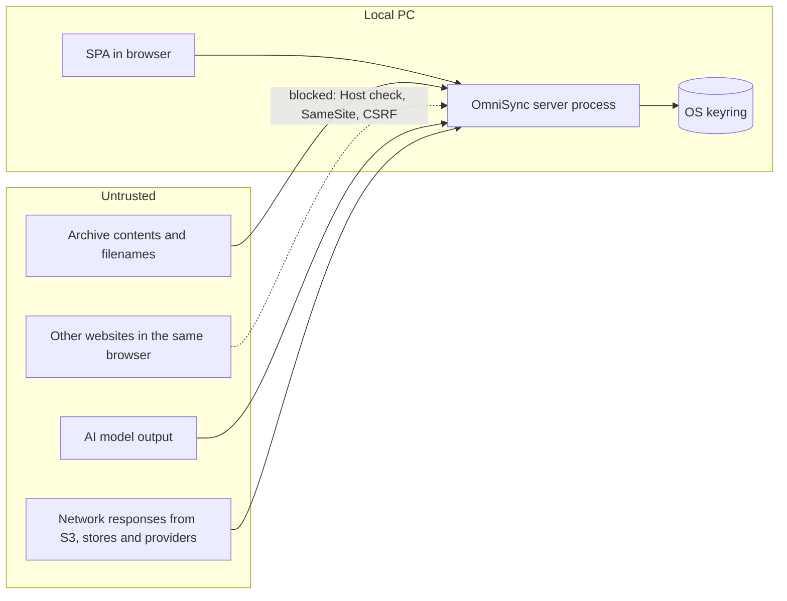

# Security Design and Threat Model

> **Status:** Accepted (approved design, not yet implemented) · **Owner:** TecHaust Technologies (@techaust) · **Last reviewed:** 2026-10-11 · **Audience:** engineers, reviewers, the owner

This document identifies what OmniSync must protect, the threats against it, and the controls that address each threat. To report a vulnerability, see [SECURITY.md](../SECURITY.md).

## 1. Assets

| Asset | Why it matters | Where it lives |
|---|---|---|
| AWS credentials | Full read/write over every product download | Environment variables or OS keyring |
| WooCommerce API keys | Read/write over every product on a store | Environment variables or OS keyring |
| AI provider API keys | Spending | Environment variables or OS keyring |
| Published objects and download links | Customers' downloads break if they are wrong or deleted | S3, stores |
| Catalog, rules, run history, audit | Correctness and accountability | SQLite, shared config |
| User passwords and sessions | Access to all of the above | SQLite (hashes only) |

## 2. Trust boundaries



*Text description:* Archive contents, other websites open in the same browser, AI output and every network response are untrusted. The server validates and constrains all of them. Only the server process reads secrets. The browser is trusted only after authentication, and only through CSRF-protected requests.

## 3. Authentication

- **Passwords:** argon2id (`argon2-cffi` defaults, at least memory 64 MiB and time cost 3); minimum length 12; checked against a bundled list of the 10,000 most common passwords.
- **First run:** a 128-bit setup token (26 base32 characters, shown in groups) is required for `POST /setup` (FR-AUTH-01). While setup is required, a new token is generated at every start, printed to the console, and written to `<data dir>/setup-token.txt` with user-only permissions. The file is deleted when setup completes. This stops any other local process or web page from claiming the instance first.
- **Sessions:** 256-bit random token in the cookie; only its SHA-256 is stored; idle expiry 12 h, absolute 7 days; revoked on logout, password change and user disable (FR-AUTH-02, FR-AUTH-04).
- **Lockout:** 10 consecutive failures lock the account for 15 min. Locked accounts receive the same `401 auth.invalid_credentials` as a wrong password or unknown username, so responses never reveal whether a username exists or is locked. Admins see lock status on the Users page.
- **Recovery:** `omnisync reset-password <user>` runs locally and requires access to the PC and the data directory.

## 4. Authorization model

Every endpoint and every AI tool declares exactly one permission ID from this table. The API layer enforces it before any handler runs (FR-AUTH-03). AI tool calls go through the same checks under the identity of the user who initiated or approved them (FR-AI-06). The endpoint-to-permission mapping is generated from the route table into the permission-matrix test ([09-TESTING-STRATEGY §7](09-TESTING-STRATEGY.md#7-security-testing)).

| Permission ID | Grants | Viewer | Operator | Admin |
|---|---|:-:|:-:|:-:|
| `view` | Read dashboard, health, archives, runs, events, catalog, rules and history, needs-input, audit, coordination status, stores, non-secret settings | ✓ | ✓ | ✓ |
| `account.self` | Own password, preferences, logout | ✓ | ✓ | ✓ |
| `ai.use` | Assistant with `read` tools; own conversations, memory and usage view; AI status | ✓ | ✓ | ✓ |
| `archives.write` | Upload, re-inspect, trash and restore archives | | ✓ | ✓ |
| `runs.write` | Create dry and live pipeline runs; cancel; resume; refresh catalog; request AI triage of run items (`explain_run_item`) | | ✓ | ✓ |
| `needs_input.resolve` | Resolve, dismiss and request suggestions for needs-input items (including the needs-input `propose` tools) | | ✓ | ✓ |
| `rules.write` | Create, edit and delete aliases, overrides and download names | | ✓ | ✓ |
| `ai.approve` | Approve or reject `approve`-class tool calls; the tool's own permission is also required | | ✓ | ✓ |
| `cleanup.manage` | Cleanup preview and execute; discard pending deletes | | | ✓ |
| `settings.manage` | Stores, S3, AI and run-default settings; connection tests | | | ✓ |
| `secrets.manage` | View secret sources; set and remove secrets | | | ✓ |
| `users.manage` | Create, disable and reset users | | | ✓ |
| `admin.data` | Audit export, backups, legacy import | | | ✓ |

## 5. Credential scoping for multiple instances

Roles in the UI protect against mistakes, not against the person who controls the PC. On the colleague's instance, real enforcement comes from **his own credentials**:

1. **A separate IAM user per instance.** The operator policy denies `s3:DeleteObject`, so his instance records pending deletes instead of deleting objects (FR-PIPE-07).
2. **His own WooCommerce API key pair** per store (WooCommerce → Settings → Advanced → REST API, permission *Read/Write*), so store-side changes can be attributed and revoked on their own.
3. **His own AI API key** if he uses AI, so spending is separated.

**Operator IAM policy** (replace `productrepo` if the bucket differs):

```json
{
  "Version": "2012-10-17",
  "Statement": [
    { "Sid": "List", "Effect": "Allow", "Action": "s3:ListBucket",
      "Resource": "arn:aws:s3:::productrepo" },
    { "Sid": "ReadWriteObjects", "Effect": "Allow",
      "Action": ["s3:GetObject", "s3:PutObject"],
      "Resource": "arn:aws:s3:::productrepo/*" },
    { "Sid": "NoDeletes", "Effect": "Deny",
      "Action": ["s3:DeleteObject", "s3:DeleteObjectVersion"],
      "Resource": "arn:aws:s3:::productrepo/*" }
  ]
}
```

**Admin IAM policy:** the same `List` and `ReadWriteObjects` statements plus `s3:DeleteObject` on `arn:aws:s3:::productrepo/*`. No other S3 or AWS permissions are needed.

`s3:ListBucket` is required even though OmniSync rarely lists objects outside cleanup. Without it, S3 answers `403` instead of `404` for missing objects, and FR-PIPE-03 would then (correctly) fail items rather than upload them.

**Recommended (owner decision):** enable **S3 Versioning** on the bucket, with a lifecycle rule that expires noncurrent versions after 30 days. Any mistaken overwrite or delete then becomes recoverable for 30 days, at the cost of storing superseded versions for that period.

## 6. Threat model

STRIDE categories: **S**poofing, **T**ampering, **R**epudiation, **I**nformation disclosure, **D**enial of service, **E**levation of privilege. Likelihood (L) and impact (I) are rated H/M/L *after* controls.

| ID | Threat | STRIDE | Controls | L | I |
|---|---|---|---|:-:|:-:|
| T-01 | A web page in the same browser sends requests to `localhost:8765` (CSRF) | S, E | C-01, C-02, C-03 | L | H |
| T-02 | DNS rebinding makes a malicious domain resolve to 127.0.0.1 and read API responses | I, E | C-04 | L | H |
| T-03 | Secrets leak through logs, API responses, backups, database or AI prompts | I | C-05, C-06, C-07 | L | H |
| T-04 | Malicious archive exhausts memory, disk or CPU (zip bomb, huge entry count, deep nesting) | D | C-08 | L | M |
| T-05 | Path traversal through an upload filename or ZIP entry names | T, E | C-09 | L | H |
| T-06 | Prompt injection: readme or header text instructs the model to take actions | T, E | C-10, C-11, C-12 | M | M |
| T-07 | The model is induced to reveal secrets or internal data | I | C-05, C-11 | L | H |
| T-08 | Password brute force against the login | S | C-13 | L | M |
| T-09 | Session theft or fixation | S | C-14 | L | H |
| T-10 | Two instances mutate concurrently (lost updates, deleting an object that was just linked) | T | C-15, C-16 | L | H |
| T-11 | A frozen lease holder resumes after takeover and performs one stale write | T | C-15, C-17 (residual risk accepted) | L | M |
| T-12 | A buggy or compromised peer instance damages the shared config | T | C-18, C-19 | L | M |
| T-13 | A compromised dependency (supply chain) | T, E | C-20 | L | H |
| T-14 | Stored XSS through filenames, readme excerpts, store titles or AI output shown in the UI | T, I | C-21, C-22 | L | H |
| T-15 | SSRF through a store base URL that points at internal services | I | C-23 | L | M |
| T-16 | A user denies having performed an action | R | C-19 | L | M |
| T-17 | The wrong download entry or product is overwritten | T | C-24 | L | H |
| T-18 | Mistaken mass deletion of S3 objects | T, D | C-16, C-25, C-26 | L | H |
| T-19 | Runaway AI spending | D | C-27 | L | M |
| T-20 | Backup archive copied off the PC exposes data | I | C-06, C-28 | L | L |

## 7. Security controls

| ID | Control | Implements |
|---|---|---|
| C-01 | `SameSite=Strict`, `HttpOnly` session cookie | NFR-SEC-04 |
| C-02 | Per-session CSRF token in the `X-CSRF-Token` header on every non-GET request | NFR-SEC-04 |
| C-03 | `Origin` header validation; CORS disabled (no `Access-Control-Allow-Origin`) | NFR-SEC-04 |
| C-04 | `Host` header allow-list (`127.0.0.1:<port>`, `localhost:<port>`); 421 otherwise; server binds to `127.0.0.1` only | NFR-SEC-04 |
| C-05 | Secrets resolved only inside `services/secrets.py`; values wrapped in a `SecretStr`-like type whose `repr`/`str` is masked; log filter redacts every known secret value; API schemas have no secret output fields | NFR-SEC-03 |
| C-06 | Secrets never stored in SQLite, shared config, backups or exports | NFR-SEC-03 |
| C-07 | Canary-secret test: CI injects a canary value as every secret and fails if it appears in any response, log, audit row, AI request or backup | NFR-SEC-03 |
| C-08 | Archive limits (FR-MATCH-05), upload size cap (FR-INBOX-03), streaming I/O, per-run temp directory with a free-disk-space check (refuse if < 2× archive size free) | FR-MATCH-05 |
| C-09 | Archives are never extracted by entry name. Stored names are generated (`<id>-<sanitised>.zip`, sanitised to `[A-Za-z0-9._-]`, maximum 120 chars). Every resolved path is checked to stay inside the data directory. | FR-INBOX-03 |
| C-10 | Untrusted text is passed to models only inside delimited data blocks labelled as untrusted, truncated to 4 KB per field, with control characters removed | FR-AI-02 |
| C-11 | Tool allow-list per role; tools cannot reach secrets, the file system or arbitrary URLs; results are size-capped and redacted | FR-AI-05 |
| C-12 | Approval gate for every `approve`-class tool; model outputs validated against schemas and allowed values (for example, the resolver choice must be in the candidate set) | FR-AI-06 |
| C-13 | argon2id hashing, lockout, login rate limit | FR-AUTH-02 |
| C-14 | 256-bit random session IDs, rotated at login, hashed at rest, server-side revocation | FR-AUTH-02 |
| C-15 | S3 conditional-write lease measured in S3 time, with write-deadline checks before every mutating call ([03-ARCHITECTURE §6.2](03-ARCHITECTURE.md#62-lease-protocol)) | FR-COORD-01 |
| C-16 | Delete only when no **configured** store (enabled or disabled) references the key. Cleanup collects references live from WooCommerce after acquiring the lease. Pipeline finalisation requires every catalog to be younger than 26 h, otherwise it records a pending delete. The control prefix is always excluded. | FR-PIPE-07, FR-CLN-01, FR-CLN-02 |
| C-17 | Idempotent pre-checks before every external write (live-state comparison) | FR-PIPE-09 |
| C-18 | Shared-config writes use ETag preconditions, schema validation on pull (an invalid document is rejected and the last good copy kept), and a 500-entry change history | FR-COORD-03 |
| C-19 | Append-only local audit log (database triggers) plus write-once shared audit objects | FR-AUD-01, FR-COORD-04 |
| C-20 | Lockfiles with hashes, `pip-audit`, `npm audit`, gitleaks, minimal dependency policy, Dependabot alerts | NFR-SEC-01, NFR-SEC-02 |
| C-21 | React default escaping; `dangerouslySetInnerHTML` banned by lint rule; AI markdown rendered with a sanitising renderer (no raw HTML) | NFR-SEC-04 |
| C-22 | CSP: `default-src 'self'; script-src 'self'; style-src 'self' 'nonce-<per-response>'; style-src-attr 'unsafe-inline'; img-src 'self' data:; connect-src 'self'; worker-src 'self'; frame-ancestors 'none'; base-uri 'none'; form-action 'self'`. The nonce lets component libraries insert `<style>` elements (Radix scroll-lock, Radix Select) without `unsafe-inline`. Inline style *attributes* are allowed by `style-src-attr` because WebKit enforces CSP on attributes that React and Radix set ([ADR-0015](adr/0015-csp-style-attributes.md)). The end-to-end suite fails on any other CSP violation in Chromium, Firefox and WebKit. Also `X-Content-Type-Options: nosniff` and `Referrer-Policy: no-referrer`. | NFR-SEC-04 |
| C-23 | Store URLs: `https://` only; admin-only; resolved IPs in loopback, private, link-local or multicast ranges are refused; redirects are not followed for API calls | FR-SET-01 |
| C-24 | Entry-selection rules (FR-PIPE-05), per-product lock, verify-after-PUT | FR-PIPE-04, FR-PIPE-05 |
| C-25 | Cleanup is admin-only, needs typed confirmation, and shows the exact key list | FR-CLN-02 |
| C-26 | Recommended S3 Versioning with 30-day noncurrent expiry (section 5) | — |
| C-27 | AI per-request token cap plus daily and monthly budgets with hard stop | FR-AI-07 |
| C-28 | Backups are written to the data directory with user-only ACLs, contain no secrets, and the restore procedure is documented | FR-OPS-02 |

## 8. Verification

| Area | Method | When |
|---|---|---|
| Permission matrix | Automated: every endpoint × every role, expected 2xx/403 | Every CI run |
| CSRF, Host, Origin, cookies, CSP headers | Automated API tests | Every CI run |
| Secret canary | C-07 | Every CI run |
| Archive limits and traversal | Fixture corpus (bombs, `../` entries, symlink entries, non-ZIP) plus Hypothesis fuzzing | Every CI run |
| Prompt injection | Red-team fixture set (readmes with embedded instructions); assert no tool executes without approval and resolver output stays in the candidate set | Every CI run (recorded model responses) plus the release eval (live model) |
| Dependencies and secrets | `pip-audit`, `npm audit --audit-level=high`, gitleaks | Every CI run plus weekly |
| ASVS L2 checklist | Manual review against the chapters listed in NFR-SEC-04, results recorded in the release report | Milestone 6 |

## 9. Residual risks (accepted)

| Risk | Reason for acceptance |
|---|---|
| T-11 one stale write after a long freeze | Requires the process to freeze in the instant between its write-deadline check and sending the request, for longer than the time to the earliest takeover: about 2.5 minutes in the worst case (renewals already failing) and about 5 minutes normally ([03-ARCHITECTURE §6.2](03-ARCHITECTURE.md#62-lease-protocol)). At most that one request is affected; its impact is bounded by the idempotent pre-checks and recorded in the audit trail. Neither WooCommerce nor S3 data writes support fencing tokens. |
| T-12 from a trusted colleague's instance | Both instances belong to trusted people. History and audit make every change visible and reversible. Shared store definitions can be changed only by an admin account, and on the colleague's PC the owner holds the admin password ([10-OPERATIONS §6](10-OPERATIONS.md#6-two-instance-setup-owner-and-colleague)). |
| A local administrator or malware on the PC can read keyring secrets | Outside the application's control. Mitigated by credential scoping (section 5) and S3 Versioning (C-26). |
